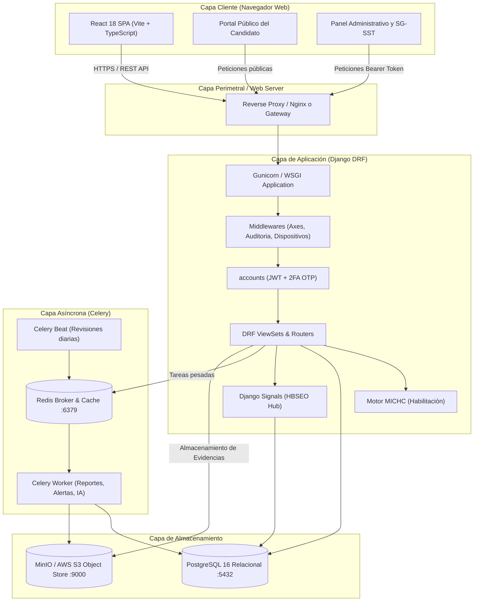
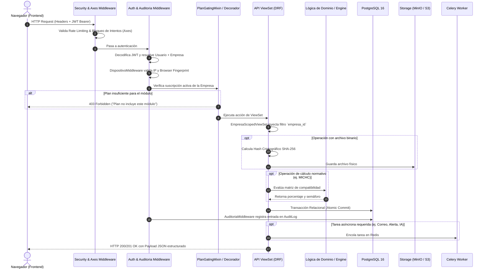

# 01 — Arquitectura General de FOSST V.I.D.A.

## 1. Stack Tecnológico y Versiones Verificadas

A partir de la inspección directa del entorno de ejecución, los archivos de configuración (`package.json`, `requirements.txt`, `Dockerfile`, `docker-compose.yml`), se verifican las siguientes tecnologías y versiones:

### 1.1 Backend
- **Lenguaje:** Python 3.11+ / 3.14 (detectado en entorno local de pruebas: Python 3.14 x64).
- **Framework Web:** Django 5.0.x / 5.1.x y Django REST Framework (DRF) 3.15.x.
- **Autenticación y Seguridad:** 
  - `django-axes` 6.x (prevención de ataques de fuerza bruta por IP y usuario).
  - `argon2-cffi` 23.x (algoritmo primario de hasheo de contraseñas de alta seguridad).
  - `djangorestframework-simplejwt` 5.3.x (autenticación stateless basada en tokens JWT con rotación).
- **Persistencia y Base de Datos:** PostgreSQL 15 / 16 como base de datos relacional única fuente de la verdad (`psycopg2-binary` / `psycopg3`).
- **Almacenamiento de Objetos / S3:** `django-storages` 1.14.x + `boto3` 1.34.x para soporte unificado de MinIO (entornos on-premise/desarrollo) o AWS S3 (producción).
- **Procesamiento Asíncrono y Colas:** Celery 5.4.x con broker Redis 7.x (`django-celery-beat` para tareas programadas periódicas).
- **Generación Documental y Ofimática:** `reportlab` 4.2.x / 5.0.x (generación de informes y FURAT en PDF con estampado criptográfico de firmas) y `openpyxl` 3.1.x (parser y exportador de plantillas masivas Excel).
- **Servicio de Inteligencia Artificial:** `anthropic` 0.25+ / `requests` / `httpx` para invocación de LLM (Claude) en clasificación CIIU y redacción de diagnósticos MICHC.
- **Documentación de API:** `drf-spectacular` 0.27.x (generación automática de especificación OpenAPI 3.0 y Swagger UI en `/api/docs/`).

### 1.2 Frontend
- **Framework:** React 18.3.x con TypeScript 5.5.x.
- **Herramienta de Construcción:** Vite 5.4.21.
- **Enrutamiento:** React Router DOM 6.26.x con rutas protegidas (`ProtectedRoute`, `RoleGuard`, `PlanGuard`).
- **Estilos e Iconografía:** Tailwind CSS 3.4.x, PostCSS, Lucide React (paquete de iconos oficial).
- **Gestión de Estado y Servidor:** TanStack React Query 5.x (`@tanstack/react-query`) para cacheo y revalidación de datos, complementado con React Context API (`AuthContext`, `BrandingContext`).
- **Utilidades UI:** `html2canvas` para captura y exportación visual de organigramas y diagramas.

---

## 2. Arquitectura Global y Topología de Servicios

FOSST V.I.D.A. adopta un patrón de **Arquitectura Desacoplada (Decoupled Client-Server)** orientada a servicios REST:



---

## 3. Estructura del Repositorio

El proyecto se distribuye en una estructura limpia de dos carpetas principales dentro de `Fosst-software-main/`:

```text
Fosst-software-main/
├── backend/                        # Núcleo Django DRF
│   ├── apps/                       # Módulos de dominio desacoplados
│   │   ├── accounts/               # Usuarios, JWT, OTP, restablecimiento y perfiles
│   │   ├── alertas/                # Reglas dinámicas de alertas y tareas periódicas
│   │   ├── auditoria/              # AuditLog transversal y middleware de auditoría
│   │   ├── calendario/             # Agenda SST, incidentes laborales y notificaciones
│   │   ├── capacitaciones/         # Registro de capacitaciones, trabajadores y asistencias
│   │   ├── common/                 # Modelos base (SoftDelete), mixins multi-tenant, storage
│   │   ├── dashboard/              # KPIs y analítica agregada por rol (con caché Redis)
│   │   ├── empresas/               # Entidad Empresa, catálogo CIIU y personalización/branding
│   │   ├── estandares/             # Res. 0312 de 2019, autoevaluaciones, respuestas y apelaciones
│   │   ├── evidencias/             # Gestión documental, hashes SHA-256 y carga multipart
│   │   ├── formacion/              # Matriz y evaluación de competencias (escala 1 a 4)
│   │   ├── gestion_humana/         # Exámenes médicos, licencias e importador masivo Excel
│   │   ├── hallazgos/              # Hallazgos de auditoría y planes de mejora automáticos
│   │   ├── hbseo/                  # Historial centralizado de brechas (GenericForeignKey)
│   │   ├── ia/                     # Cliente Anthropic Claude con fallback determinista
│   │   ├── informes/               # ReportLab PDF, generación de balances y firmas digitales
│   │   ├── michc/                  # Motor de habilitación y cumplimiento técnico-médico
│   │   ├── organizacion/           # Sedes, organigrama interactivo, mapa de procesos y contexto
│   │   ├── perfilcargo/            # Descriptores de cargo, peligros GTC 45 y versionado inmutable
│   │   ├── planes/                 # Catálogo de suscripciones y decorador de gating
│   │   ├── reclutamiento/          # Banco de talento, vacantes, procesos y portal del candidato
│   │   └── seguridad/              # Dispositivos confiables, bloqueo y eventos de riesgo
│   ├── config/                     # Configuración central (settings, urls, celery, wsgi)
│   ├── templates/                  # Plantillas HTML/texto de correos transaccionales
│   ├── manage.py                   # CLI administrativo de Django
│   ├── requirements.txt            # Dependencias Python
│   └── Dockerfile                  # Contenedor de producción
├── frontend/                       # Aplicación SPA React
│   ├── src/
│   │   ├── components/             # UI reutilizable (Card, Badge, Button, Modal, Forms)
│   │   │   └── layout/             # AppShell, barras de navegación y popovers de alerta
│   │   ├── pages/                  # Vistas segregadas por rol de usuario
│   │   │   ├── auth/               # Login, Registro, OTP, Recuperación de contraseña
│   │   │   ├── portal/             # Portal público de vacantes y seguimiento de candidatos
│   │   │   ├── responsable/        # Vistas operativas del Responsable SG-SST y configuración
│   │   │   ├── auditor/            # Vistas del Auditor (hallazgos, apelaciones, informe)
│   │   │   └── altadireccion/      # Vistas estratégicas de gerencia y dashboards
│   │   ├── router/                 # Configuración de React Router y Guards de seguridad
│   │   ├── services/               # Clientes Axios tipados hacia la API REST
│   │   ├── store/                  # Contextos globales (AuthContext, BrandingContext)
│   │   └── types/                  # Definiciones e interfaces TypeScript
│   ├── package.json                # Dependencias Node.js
│   ├── tailwind.config.js          # Configuración de estilos y temas corporativos
│   └── vite.config.ts              # Configuración de compilación y servidor Vite
├── docker-compose.yml              # Orquestador local (PostgreSQL 16, Redis 7, MinIO S3)
└── README.md                       # Guía de inicio rápido
```

---

## 4. Flujo de Comunicación entre Capas y Secuencia de una Petición

Toda petición HTTP transita por una rigurosa tubería de middlewares y capas de control antes de tocar la base de datos:



---

## 5. Autenticación, Autorización y Contexto Multi-Tenant

### 5.1 Esquema de Autenticación en Dos Pasos (2FA OTP)
El proceso de login en FOSST V.I.D.A. no emite el token final en el primer paso:
1. `POST /api/auth/login/`: Valida el número de documento, correo y contraseña cifrada con Argon2. Si las credenciales son correctas, el backend **no entrega un token de acceso**, sino que genera un código OTP numérico de 6 dígitos con vigencia estricta de 5 minutos (`apps/accounts/models.py:CodigoOTP`) y lo envía de forma asíncrona al correo del usuario vía Celery.
2. `POST /api/auth/verificar-otp/`: El usuario suministra el código recibido. Tras validarse que no esté vencido ni usado, el sistema emite el par de tokens JWT:
   - `access`: Vida útil corta de 15 minutos (`ACCESS_TOKEN_LIFETIME = timedelta(minutes=15)`).
   - `refresh`: Con rotación obligatoria para solicitar nuevos access tokens.

### 5.2 Roles de Usuario (RBAC)
FOSST V.I.D.A. maneja un esquema estricto de roles empresariales definidos en `apps/accounts/models.py:UserRole`:
- `ADMIN`: Administrador global de la plataforma (acceso transversal a todas las empresas).
- `RESPONSABLE`: Responsable del Sistema de Gestión de SST de la empresa (gestión de estándares, evidencias, gestión humana, planes de mejora y reclutamiento).
- `AUDITOR`: Auditor técnico (revisión de evaluaciones, emisión de hallazgos, dictamen de apelaciones).
- `ALTA_DIRECCION`: Representante legal o gerencia (visualización ejecutiva de dashboards, firma de informes finales).
- `EMPLEADO`: Consulta de perfil propio, certificaciones y capacitaciones.

### 5.3 Aislamiento Multi-Tenant
El multi-tenancy se garantiza en backend mediante la clase base abstracta `apps/common/mixins.py:EmpresaScopedViewSet`:
- Sobrescribe `get_queryset()` forzando automáticamente que toda consulta filtre por `empresa=request.user.empresa`.
- En operaciones de creación (`perform_create`), asigna programáticamente `serializer.save(empresa=request.user.empresa)` impidiendo que un atacante inyecte un `empresa_id` arbitrario en el cuerpo JSON de la petición.
- Si un usuario con rol auditor intenta interactuar con registros de una empresa a la que no está asignado, el middleware o el queryset vacío retorna `404 Not Found` o `403 Forbidden`.

---

## 6. Persistencia, Almacenamiento y Tareas Asíncronas

### 6.1 Persistencia Transaccional y Borrado Lógico
- Se prohíbe la eliminación física en tablas transaccionales mediante la clase abstracta `apps/common/models.py:SoftDeleteModel`, la cual incorpora los campos `is_deleted` (booleano) y `deleted_at` (timestamp).
- Las vistas heredan de repositorios que filtran automáticamente `deleted_at__isnull=True`.

### 6.2 Almacenamiento Criptográfico de Archivos
- Las evidencias, soportes de exámenes médicos y documentos adjuntos se procesan mediante `apps/evidencias/models.py:Archivo`.
- Al recibirse el archivo binario, el backend calcula el hash **SHA-256** del flujo de bytes y lo persiste en la base de datos junto con el tipo MIME, tamaño y ruta del storage. Esto garantiza la cadena de custodia probatoria requerida en auditorías judiciales o laborales.

### 6.3 Tareas en Segundo Plano y Cron (Celery Beat)
- **Broker y Backend:** Redis 7.x en `localhost:6379`.
- **Tareas Asíncronas Inmediatas (`@shared_task`):**
  - Envío de correos de activación de cuenta, OTP y alertas de seguridad (`apps/accounts/tasks.py`).
  - Diagnóstico asistido por IA para la matriz MICHC (`apps/michc/tasks.py`).
  - Generación pesada de archivos PDF y procesamiento de importación de plantillas Excel (`apps/gestion_humana/importador.py`).
- **Tareas Programadas Diarias (Celery Beat Schedule):**
  - `revisar_vencimientos` (`apps/alertas/tasks.py`): Evalúa cada medianoche las reglas de vencimiento de contratos, licencias de conducción, exámenes ocupacionales y afiliaciones a seguridad social, generando notificaciones deduplicadas.
