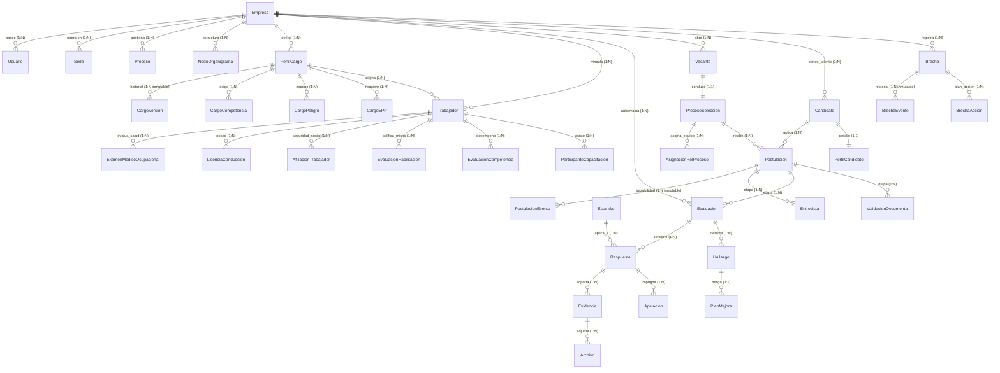

# 03 — Modelo de Datos y Persistencia de FOSST V.I.D.A.

## 1. Esquema de Entidades y Relaciones Principales

La persistencia de FOSST V.I.D.A. está centralizada en **PostgreSQL**, articulada en torno al aislamiento multi-tenant por empresa y al ciclo PHVA del Sistema de Gestión de Seguridad y Salud en el Trabajo.

A continuación se presenta el diagrama de entidad-relación (ERD) representativo de los núcleos del sistema:

---

## 2. Detalle de Modelos Fundamentales por Dominio

### 2.1 Núcleo de Organización y Cargos
- **`Empresa` (`apps.empresas.models.Empresa`):**
  - Campos clave: `id` (UUID), `nit` (único), `razon_social`, `ciiu` (código a 4 dígitos Decreto 768), `clase_riesgo` (I a V), `numero_trabajadores` (entero), `capitulo_vigente` (Capítulo I, II o III), `branding` (JSON: colores primario, secundario y logo URL).
- **`PerfilCargo` (`apps.perfilcargo.models.PerfilCargo`):**
  - Campos clave: `id` (UUID), `empresa` (FK), `nombre`, `codigo`, `area`, `sede` (FK), `proceso` (FK), `clase_riesgo_arl`, `jefe_inmediato` (FK reflexiva a `PerfilCargo`), `suplente` (FK a `PerfilCargo`), `cargo_critico` (booleano).
  - Criticidades en 5 dimensiones (escala *Baja, Media, Alta, Crítica*): `criticidad_sst`, `criticidad_operacional`, `criticidad_vial`, `criticidad_ambiental`, `criticidad_estrategica`.
  - Propósito y funciones: `proposito_cargo`, `responsabilidades_decreto_1072` (textos derivados del Art. 2.2.4.6.10).
- **`CargoVersion` (`apps.perfilcargo.models.CargoVersion`):**
  - Instantánea inmutable: `cargo` (FK), `version_numero` (entero secuencial), `snapshot_data` (JSON estructurado con todas las funciones, peligros y competencias del momento), `modificado_por` (FK a `Usuario`), `created_at`.

### 2.2 Núcleo de Gestión Humana y Trabajadores
- **`Trabajador` (`apps.capacitaciones.models.Trabajador`):**
  - Campos clave: `id` (UUID), `empresa` (FK), `perfil_cargo` (FK opcional), `tipo_documento`, `documento`, `nombre`, `email`, `cargo` (texto descriptivo), `tipo_contrato` (*Indefinido, Fijo, Obra, Aprendizaje, Prestación*), `fecha_ingreso`, `fecha_fin_contrato`, `salario_base`, `activo` (booleano), `deleted_at`.
  - Restricción de base de datos: `UniqueConstraint(fields=["empresa", "documento"])`.
- **`ExamenMedicoOcupacional` (`apps.gestion_humana.models.ExamenMedicoOcupacional`):**
  - Campos: `trabajador` (FK), `tipo_examen` (*Ingreso, Periódico, Egreso, Reintegro*), `fecha_realizacion`, `fecha_vencimiento`, `concepto_aptitud` (*Apto, Apto con restricciones, No apto*), `tiene_restricciones` (booleano), `detalle_restricciones`, `archivo_concepto` (FK a `Archivo`).
- **`LicenciaConduccion` (`apps.gestion_humana.models.LicenciaConduccion`):**
  - Campos: `trabajador` (FK), `numero_licencia`, `categoria` (*A1, A2, B1, B2, B3, C1, C2, C3*), `fecha_expedicion`, `fecha_vencimiento`.

### 2.3 Núcleo de Reclutamiento y Selección
- **`Candidato` (`apps.reclutamiento.models.Candidato`):**
  - Campos: `id` (UUID), `empresa` (FK), `tipo_documento`, `documento`, `nombres`, `apellidos`, `email`, `telefono`, `ciudad`, `autoriza_habeas_data` (booleano obligatorio), `fecha_autorizacion_habeas_data`, `created_at`.
  - Restricción: `UniqueConstraint(fields=["empresa", "documento"])`.
- **`Vacante` (`apps.reclutamiento.models.Vacante`):**
  - Campos: `id` (UUID), `empresa` (FK), `codigo` (`VAC-YYYY-NNNN`), `titulo`, `perfil_cargo` (FK), `cupos` (entero $\ge 1$), `cupos_cubiertos` (entero $\le$ `cupos`), `estado` (*Borrador, Abierta, Suspendida, Cubierta, Cancelada*), `publicada_en_portal` (booleano).
- **`ProcesoSeleccion` (`apps.reclutamiento.models.ProcesoSeleccion`):**
  - Campos: `vacante` (OneToOne), `codigo` (`PROC-YYYY-NNNN`), `responsable_rh` (FK a `Usuario`), `etapas_obligatorias` (JSON array: ej. `["revision_cv", "entrevista", "evaluacion_tecnica", "validacion_documental"]`), `estado` (*Activo, Pausado, Finalizado, Cancelado*).
- **`Postulacion` (`apps.reclutamiento.models.Postulacion`):**
  - Campos: `id` (UUID), `candidato` (FK), `proceso` (FK), `estado` (*POSTULADO, EN_REVISION, PRESELECCIONADO, EN_ENTREVISTA, EN_EVALUACION, EN_VALIDACION, SELECCIONADO, NO_SELECCIONADO, RETIRO_CANDIDATURA, NO_CONTINUO*), `motivo_cierre`, `es_excepcion` (booleano), `justificacion_excepcion`.
  - Restricción: `UniqueConstraint(fields=["candidato", "proceso"])` (impide doble postulación al mismo proceso).
- **`PostulacionEvento` (`apps.reclutamiento.models.PostulacionEvento`):**
  - Bitácora inmutable: `postulacion` (FK), `tipo_evento`, `estado_origen`, `estado_destino`, `usuario` (FK), `motivo`, `detalles` (JSON), `created_at`.

### 2.4 Núcleo de Habilitación y Brechas (MICHC y HBSEO)
- **`EvaluacionHabilitacion` (`apps.michc.models.EvaluacionHabilitacion`):**
  - Campos: `trabajador` (FK), `perfil_cargo` (FK), `fecha_calculo`, `porcentaje_cumplimiento` (Decimal 0.00 a 100.00), `semaforo` (*VERDE, AMARILLO, ROJO*), `estado_habilitacion` (*HABILITADO, RESTRINGIDO, PENDIENTE_DOCUMENTAL, NO_APTO*), `factores_evaluados` (JSON detallado con los 9 factores).
- **`Brecha` (`apps.hbseo.models.Brecha`):**
  - Campos: `empresa` (FK), `codigo` (`BRC-YYYY-NNNN`), `tipo` (*Normativa, Habilitación, Competencia, Auditoría*), `titulo`, `descripcion`, `criticidad` (*Baja, Media, Alta, Crítica*), `estado` (*Detectada, En tratamiento, Controlada, Subsanada, Cerrada*).
- **`BrechaOrigen` (`apps.hbseo.models.BrechaOrigen`):**
  - Enlace polimórfico: `brecha` (OneToOne), `content_type` (FK a `ContentType`), `object_id` (CharField/UUID) $\rightarrow$ Permite ligar la brecha a `EvaluacionHabilitacion`, `EvaluacionCompetencia` o `Hallazgo`.

### 2.5 Núcleo de Estándares Mínimos y Auditoría
- **`Evaluacion` (`apps.estandares.models.Evaluacion`):**
  - Campos: `empresa` (FK), `anio` (entero), `puntaje_obtenido` (Decimal), `estado` (*En progreso, Finalizada*).
- **`Respuesta` (`apps.estandares.models.Respuesta`):**
  - Campos: `evaluacion` (FK), `estandar` (FK), `cumple` (booleano), `no_aplica` (booleano), `justificacion_no_aplica`, `observaciones`.
- **`Apelacion` (`apps.estandares.models.Apelacion`):**
  - Campos: `respuesta` (FK), `solicitante` (FK `Usuario`), `motivo`, `estado` (*Pendiente, Aceptada, Rechazada, Resuelta*), `respuesta_auditor`.
- **`Archivo` (`apps.evidencias.models.Archivo`):**
  - Campos: `nombre_original`, `archivo` (FileField S3/MinIO), `sha256_hash` (CharField 64 hex digest), `mime_type`, `tamano_bytes`, `is_deleted`, `deleted_at`.
- **`AuditLog` (`apps.auditoria.models.AuditLog`):**
  - Bitácora transversal: `empresa` (FK opcional), `usuario` (FK), `metodo_http`, `ruta`, `ip_address`, `status_code`, `valores_anteriores` (JSON), `valores_nuevos` (JSON), `created_at`.

---

## 3. Enumeraciones y Estados Críticos

| Entidad | Campo | Valores Enumerados Posibles |
|---|---|---|
| `Usuario` | `rol` | `ADMIN`, `RESPONSABLE`, `AUDITOR`, `ALTA_DIRECCION`, `EMPLEADO` |
| `Empresa` | `clase_riesgo` | `I`, `II`, `III`, `IV`, `V` |
| `Empresa` | `capitulo_vigente` | `CAPITULO_I` (7 estándares), `CAPITULO_II` (21 estándares), `CAPITULO_III` (60 estándares) |
| `PerfilCargo` | `criticidades` | `BAJA`, `MEDIA`, `ALTA`, `CRITICA` |
| `CargoCompetencia`| `nivel_requerido`| `1` (Básico), `2` (Intermedio), `3` (Avanzado), `4` (Experto) |
| `Vacante` | `estado` | `BORRADOR`, `ABIERTA`, `SUSPENDIDA`, `CUBIERTA`, `CANCELADA` |
| `Postulacion` | `estado` | `POSTULADO`, `EN_REVISION`, `PRESELECCIONADO`, `EN_ENTREVISTA`, `EN_EVALUACION`, `EN_VALIDACION`, `SELECCIONADO`, `NO_SELECCIONADO`, `RETIRO_CANDIDATURA`, `NO_CONTINUO` |
| `EvaluacionHabilitacion` | `semaforo` | `VERDE` ($\ge 100\%$), `AMARILLO` ($80-99\%$), `ROJO` ($<80\%$) |
| `Brecha` | `estado` | `DETECTADA`, `EN_TRATAMIENTO`, `CONTROLADA`, `SUBSANADA`, `CERRADA` |
| `Notificacion` | `nivel` | `NORMAL`, `IMPORTANTE`, `CRITICO` |

---

## 4. Migraciones y Consistencia de Base de Datos

Las migraciones de Django han sido consolidadas y verificadas en ejecución contra PostgreSQL 16. Destacan por su impacto estructural:
1. `evidencias.0002_archivo_deleted_at_archivo_sha256_hash_and_more`: Añade campos de integridad SHA-256 y SoftDelete a nivel de base de datos.
2. `reclutamiento.0001_initial` a `0003_asignacion_rol_proceso`: Construye la estructura completa de Banco de Talento, convocatorias y roles específicos por proceso.
3. `perfilcargo.0003_perfilcargo_fase1_extendido` y `0004`: Agrega criticidades en 5 dimensiones, jerarquías reflexivas y versionado inmutable.
4. `organizacion.0004_proceso_nombre_normalizado_y_unicidad`: Aplica restricciones de unicidad sobre procesos y nodos de organigrama por empresa.
