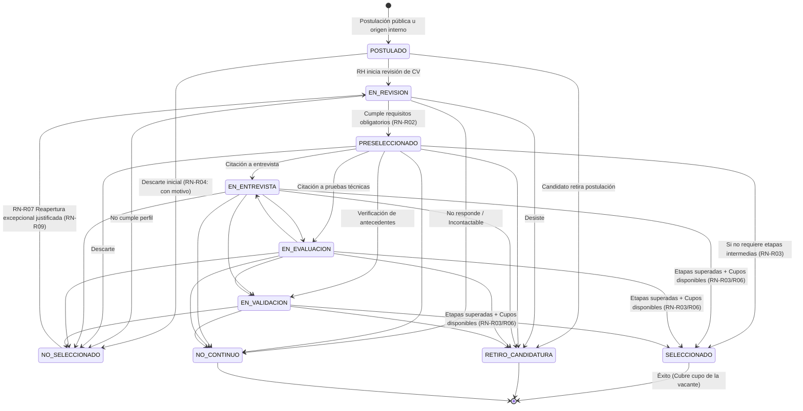
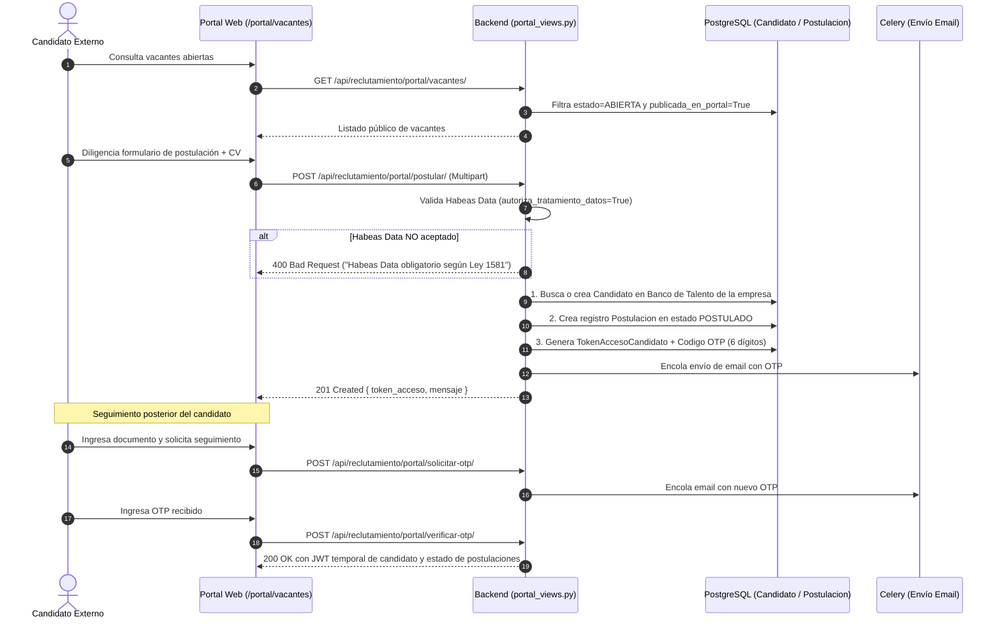

# 05 — Documentación Profunda del Módulo de Reclutamiento y Selección

## 1. Visión General del Dominio de Reclutamiento

El módulo de Reclutamiento y Selección (`apps/reclutamiento`) implementa la gestión integral de atracción, selección y contratación de personal para las organizaciones clientes de FOSST V.I.D.A.

Su diseño satisface tres principios arquitectónicos cardinales:
1. **Aislamiento Multi-Tenant Absoluto (RN-R10):** El Banco de Talento de cada empresa es un espacio completamente estanco. Un candidato registrado en la Empresa A jamás es visible por la Empresa B, aún si la misma persona física (mismo documento o email) se postula a vacantes de ambas organizaciones.
2. **Independencia Estructural Candidato vs. Postulación:** El estado del proceso pertenece exclusivamente a la relación viva `Postulacion`, nunca al `Candidato`. Un mismo candidato puede estar `NO_SELECCIONADO` en un proceso antiguo y simultáneamente `EN_ENTREVISTA` en una nueva convocatoria sin colisión.
3. **Inmutabilidad y Trazabilidad Forense (RN-R08):** Cada transición de estado, evaluación, prueba o reapertura excepcional queda grabada como un evento inmutable en `PostulacionEvento` con autor, timestamp y justificación.

---

## 2. Máquina de Estados de Postulación (RN-R01 a RN-R09)

La gestión de los aspirantes se rige por una máquina de estados determinista gobernada por la tabla declarativa `ESTADO_TRANSICIONES` en `apps/reclutamiento/services/transiciones.py`:

### Reglas de Negocio Verificadas en Código:
- **RN-R01 (Validación Estricta de Transición):** Solo se permiten los saltos declarados en `ESTADO_TRANSICIONES`. Intentar saltar arbitrariamente (ej. de `POSTULADO` directo a `SELECCIONADO`) dispara `TransicionInvalidaError`.
- **RN-R02 (Filtro Duro de Requisitos Obligatorios):** Para pasar a `PRESELECCIONADO`, el aspirante debe cumplir todos los requisitos calificados como obligatorios en el perfil de cargo o proceso. Si falta alguno, se rechaza salvo autorización por excepción (`es_excepcion=True`).
- **RN-R03 (Completitud de Etapas Obligatorias):** Para alcanzar el estado `SELECCIONADO`, el candidato debe haber registrado y aprobado todas las etapas configuradas para la vacante (`requiere_entrevista`, `requiere_evaluacion`, `requiere_validacion_documental`).
- **RN-R04 (Motivo Obligatorio en Cierre):** El cierre hacia `NO_SELECCIONADO`, `RETIRO_CANDIDATURA` o `NO_CONTINUO` exige un texto descriptivo del motivo. Se prohíbe el cierre con motivo vacío.
- **RN-R05 (Tratamiento del Retiro Voluntario):** Cuando el candidato decide no continuar, el estado debe ser `RETIRO_CANDIDATURA`, preservando la postulación y manteniendo intacto el registro del candidato en el Banco de Talento.
- **RN-R06 (Cierre Automático por Cupos Cubiertos):** Al seleccionarse el número de candidatos igual al cupo de la vacante (`cupos_cubiertos == numero_cupos`), la vacante pasa automáticamente a `CUBIERTA` y el sistema ejecuta el cierre de las demás postulaciones activas con motivo `"Vacante cubierta"`.
- **RN-R07 (Reapertura Excepcional):** Una postulación en `NO_SELECCIONADO` puede reabrirse excepcionalmente a `EN_REVISION`. La acción genera un nuevo registro en `PostulacionEvento` conservando la historia previa.
- **RN-R08 (Bitácora Inmutable de Eventos):** Cada cambio de estado genera una fila en `PostulacionEvento` con `tipo_evento="CAMBIO_ESTADO"`, `estado_origen`, `estado_destino`, `usuario_id` y timestamp.
- **RN-R09 (Auditoría de Excepciones):** Toda transición forzada por excepción exige `es_excepcion=True`, `justificacion_excepcion` detallada y el usuario autorizador.

---

## 3. Arquitectura del Portal Público del Candidato

El subsistema público de empleo (`apps/reclutamiento/portal_views.py`) expone una interfaz desacoplada para aspirantes externos sin comprometer el área administrativa:

---

## 4. Roles y Permisos por Convocatoria (`AsignacionRolProceso`)

Para empresas con múltiples evaluadores o psicólogos externos, el sistema implementa un control de acceso granular por convocatoria (`apps/reclutamiento/permissions.py:IsRolReclutamientoPermitido`):
- **EVALUADOR:** Puede calificar entrevistas y registrar evaluaciones técnicas de los candidatos de ese proceso específico, pero no puede cambiar estados finales ni alterar la vacante.
- **RECLUTADOR:** Tiene control operativo sobre las postulaciones, transiciones de estado y preselección del proceso asignado.
- **VISUALIZADOR:** Acceso de solo lectura a los aspirantes y resultados de la convocatoria.
- **RESPONSABLE SST / ADMIN:** Control total jerárquico sobre todos los procesos de la empresa.

---

## 5. Respaldo de Pruebas Automatizadas Verificadas

La integridad de este módulo fue auditada y verificada mediante la ejecución exitosa de la suite completa en `apps/reclutamiento/tests/` (25 pruebas ejecutadas sin errores):

| Suite de Prueba | Archivo de Prueba | Casos Verificados | Resultado |
|---|---|---|---|
| **Fase A (Modelos Base)** | `test_fase_a.py` | Creación de candidatos, perfil 1:1, unicidad de documento por empresa, aislamiento multi-tenant cruzado y generación de códigos correlativos `VAC-*` y `PROC-*`. | **PASS (5/5)** |
| **Fase B (Transiciones)** | `test_fase_b_transiciones.py` | Validación de máquina de estados, bloqueo de transiciones inválidas, requisitos obligatorios, etapas faltantes, motivo obligatorio, cierre por cupos y reaperturas excepcionales. | **PASS (7/7)** |
| **Fase C (Etapas)** | `test_fase_c_etapas.py` | Registro de entrevistas, pruebas psicotécnicas, validación de antecedentes, reprobación de etapas y flujo integral de selección. | **PASS (2/2)** |
| **Fase D (Endpoints REST)** | `test_fase_d_endpoints.py` | CRUD de vacantes, Banco de Talento, endpoints de cambio de estado, acciones de cierre y filtros de aislamiento empresarial. | **PASS (5/5)** |
| **Fase E (Portal Público)** | `test_fase_e_portal.py` | Listado público de vacantes, postulación anónima con consentimiento de Habeas Data, emisión y verificación de OTP para autoconsulta y retiro voluntario. | **PASS (6/6)** |
