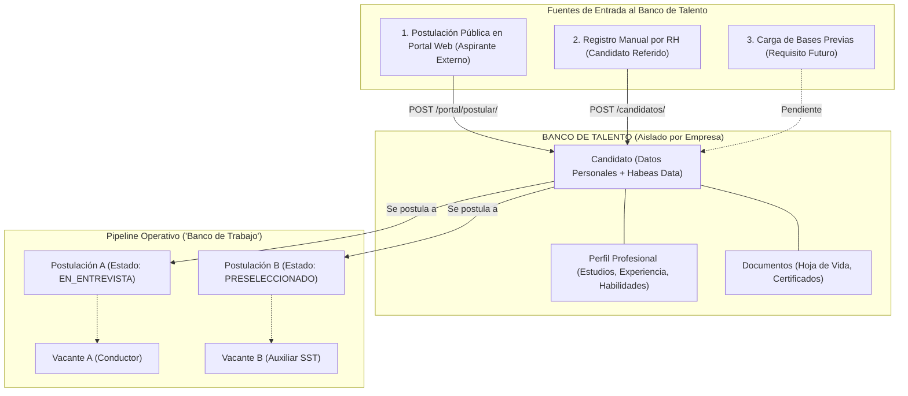

# 06 — Investigación y Análisis: Banco de Trabajo vs. Banco de Talento

## 1. Planteamiento del Problema y Análisis Terminológico

En la formulación inicial de requerimientos del cliente y en diversas minutas de trabajo surgen indistintamente los términos **"Banco de Talento"** y **"Banco de Trabajo"**. 

Uno de los objetivos esenciales de esta auditoría es determinar si en FOSST V.I.D.A. estos conceptos representan:
- Dos módulos o entidades independientes de base de datos.
- Una sinonimia funcional para referirse al repositorio de candidatos.
- O una distinción entre el **repositorio pasivo de candidatos** (*Banco de Talento*) y la **bandeja operativa de gestión de convocatorias** (*Banco de Trabajo*).

Tras la inspección minuciosa del documento oficial del cliente (`MODULOS A TRABAJAR VERSIÓN 02.docx`), el diccionario de datos (`FOSST_VIDA_Diccionario_de_Datos_Oficial.md`), los modelos backend (`apps/reclutamiento/models.py`) y la interfaz React (`ReclutamientoView.tsx`), se concluye de forma concluyente:

> **Dictamen Técnico:**  
> En el código fuente existente **NO existe una tabla, entidad relacional ni archivo denominado `BancoDeTrabajo`**.  
> El concepto normativo formal en la base de datos es **`Banco de Talento`** (materializado en la tabla `reclutamiento_candidatos` y su interfaz tabulada `Tab 1: Banco de Talento`).  
> Lo que en requerimientos se denominaba coloquialmente *"Banco de Trabajo"* corresponde funcionalmente al **Tablero Operativo de Convocatorias y Pipeline** (`Tab 3: Procesos de Selección & Pipeline` en `ReclutamientoView.tsx`), donde el reclutador ejecuta el trabajo diario de tamizaje, entrevistas y evaluación de postulaciones.

---

## 2. Contraste entre Requerimientos del Cliente y Código Real

| Dimensión de Análisis | Especificación del Cliente (`MODULOS A TRABAJAR V02`) | Implementación Real en Backend | Interfaz de Usuario en Frontend (`ReclutamientoView.tsx`) | Evidencia y Estado |
|---|---|---|---|---|
| **Definición de Banco de Talento** | "Cada cliente de FOSST V.I.D.A. tendrá su propio espacio aislado llamado BANCO DE TALENTO... repositorio principal de personas independientes de una vacante." | Modelo `Candidato` (`reclutamiento_candidatos`) con FK a `Empresa` y restricción `UniqueConstraint(fields=["empresa", "documento"])`. | Pestaña **`banco` ("Banco de Talento")**: Tabla con buscador, filtros por ciudad/profesión, modal de detalle y botón "Nuevo Candidato". | **[IMPLEMENTADO Y VERIFICADO]** |
| **Definición de "Banco de Trabajo"** | Mención a la gestión operativa, revisión de postulaciones y ejecución de filtros diarios por vacante. | Manejado mediante las entidades `ProcesoSeleccion`, `Postulacion`, `PostulacionEvento` y los servicios `etapas.py` y `transiciones.py`. | Pestaña **`procesos` ("Procesos de Selección & Pipeline")**: Selector de vacante, tabla de postulaciones filtradas por estado, y modales de acción (Entrevista, Evaluación, Preselección). | **[IMPLEMENTADO Y VERIFICADO]** (como tablero de procesos, no como entidad separada). |
| **Aislamiento Multi-Tenant** | "Empresa A jamás podrá consultar candidatos de Empresa B." | Cumplido rigurosamente mediante `Candidato.objects.filter(empresa=request.user.empresa)`. Probado en `test_fase_a.py`. | La vista consume `reclutamientoService.listarCandidatos()` que inyecta automáticamente el token del tenant. | **[PROBADO SATISFACTORIAMENTE]** |
| **Reutilización de Candidatos** | Un candidato registrado previamente debe poder ser postulado a nuevas vacantes sin duplicar su registro básico. | El candidato persiste en `Candidato`. Para un nuevo proceso, se crea únicamente una nueva fila en `Postulacion`. | Modal de postulación interna: Permite asociar un candidato existente a una nueva vacante. | **[IMPLEMENTADO Y VERIFICADO]** |
| **Habeas Data (Ley 1581)** | Consentimiento explícito obligatorio para el tratamiento de datos personales. | Campo booleano `autoriza_tratamiento_datos` y fecha. Bloquea postulación pública en `portal_views.py` si es `False`. | Checkbox obligatorio con enlace legal en formularios de creación y portal del candidato. | **[PROBADO SATISFACTORIAMENTE]** |

---

## 3. Arquitectura del Banco de Talento

El Banco de Talento opera como un maestro de aspirantes independiente:

### Características Verificadas del Banco de Talento:
1. **Filtros y Búsqueda Avanzada:**
   - La API (`/api/reclutamiento/candidatos/`) soporta búsqueda por documento, nombres, apellidos, correo electrónico y ciudad.
   - En el frontend, el campo de búsqueda filtra local y remotamente los candidatos activos.
2. **Historial Completo de Postulaciones:**
   - Al consultar el detalle de un candidato (`GET /api/reclutamiento/candidatos/{id}/`), el backend incluye el array serializado de todas las postulaciones históricas del aspirante en la empresa, mostrando la vacante, fecha y estado final obtenido.
3. **Inexistencia de Colisión entre Tenants:**
   - Si la persona física con cédula `10203040` se postula a la Empresa "Transportes S.A." y luego a "Minería S.A.", el sistema crea dos registros independientes de `Candidato` con IDs distintos, cada uno asociado a su respectiva empresa. Ningún dato ni anotación interna se comparte.

---

## 4. Funcionalidades Solicitadas vs. Brechas Detectadas

A partir del cotejo entre el documento `MODULOS A TRABAJAR VERSIÓN 02.docx` y el repositorio real:

1. **Importación Masiva de Candidatos al Banco de Talento:**
   - *Estado:* **[PARCIAL / PENDIENTE EN BANCO DE TALENTO]**.
   - *Hallazgo:* Se implementó un importador masivo en Excel para *Trabajadores Activos* (`apps/gestion_humana/importador.py`), pero no se construyó un parser masivo equivalente para cargar hojas de cálculo de *Candidatos* en Reclutamiento. Actualmente los candidatos se crean uno a uno por la UI o a través del portal público.
2. **Alertas Automáticas de Reutilización:**
   - *Estado:* **[PENDIENTE]**.
   - *Hallazgo:* El cliente solicitó que al abrir una vacante, el sistema sugiera automáticamente candidatos preexistentes en el Banco de Talento con perfiles similares. Actualmente el reclutador debe consultar manualmente el Banco de Talento y crear la postulación.
3. **Vinculación Automática a Trabajador tras Selección:**
   - *Estado:* **[PARCIAL]**.
   - *Hallazgo:* Cuando una postulación alcanza el estado `SELECCIONADO`, el proceso culmina con éxito en reclutamiento; sin embargo, no existe un disparador automático que cree el registro correspondiente en la tabla `Trabajador` de `capacitaciones`. El alta del trabajador debe ser registrada por Gestión Humana.

---

## 5. Preguntas Clave para Decisión del Cliente

Para cerrar definitivamente la ambigüedad conceptual en futuras iteraciones de desarrollo, se recomienda formular al cliente las siguientes precisiones:

1. **Definición de Términos:** ¿El término "Banco de Trabajo" que mencionaron en reuniones es simplemente el tablero de gestión de procesos actual (Pipeline de selección por vacante), o requieren una bandeja de entrada global unificada donde aparezcan todas las tareas pendientes del reclutador (ej. todas las entrevistas de hoy de todas las vacantes)?
2. **Transición a Trabajador:** ¿Desean que al cambiar una postulación a `SELECCIONADO` el sistema cree automáticamente un borrador de empleado en la app de Gestión Humana, o prefieren mantener la separación estricta para que el contrato se legalice manualmente?
3. **Expiración de Datos (Habeas Data):** ¿Debe implementarse una política de purga automática de candidatos en el Banco de Talento tras 12 o 24 meses sin actividad, en estricto cumplimiento de la Ley de Protección de Datos Personales?
