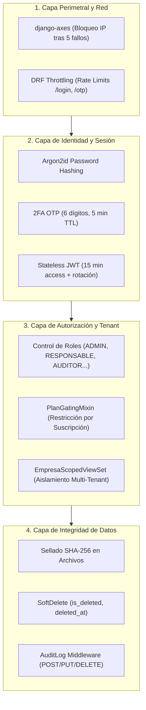

# 10 — Seguridad, Gestión de Riesgos y Guía de Mantenimiento

## 1. Arquitectura de Seguridad de FOSST V.I.D.A.

La seguridad en FOSST V.I.D.A. está estructurada bajo el principio de **Defensa en Profundidad (Defense in Depth)**, cubriendo múltiples capas desde la red perimetral hasta el nivel de fila en la base de datos.



---

## 2. Puntos Críticos de Seguridad y Privacidad

### 2.1 Aislamiento Multi-Tenant
- **Riesgo:** Fuga transversal de información entre empresas rivales (*Data Leakage*).
- **Mecanismo de Mitigación:** Todo `ModelViewSet` en el backend debe heredar obligatoriamente de `EmpresaScopedViewSet` (`apps/common/mixins.py`). Este mixin intercepta el queryset e inyecta la cláusula `WHERE empresa_id = request.user.empresa_id` de forma automática.
- **Regla de Desarrollo:** Nunca utilice `Model.objects.all()` en vistas accesibles por usuarios normales sin aplicar filtro de tenant.

### 2.2 Protección de Datos Personales (Habeas Data — Ley 1581 de 2012)
- El Banco de Talento (`apps/reclutamiento/models.py:Candidato`) almacena hojas de vida, teléfonos y correos de aspirantes externos.
- La base de datos impone el campo `autoriza_tratamiento_datos=True` y almacena la fecha/hora exacta en `fecha_autorizacion_datos`. La API pública de postulación rechaza de plano con código `400 Bad Request` cualquier envío que no marque la casilla legal.

### 2.3 Seguridad de Archivos y S3
- Se prohíbe la subida directa de ejecutables (`.exe`, `.sh`, `.bat`). El archivo `settings.py` valida la lista blanca de tipos MIME:
  `["application/pdf", "image/png", "image/jpeg", "application/vnd.openxmlformats-officedocument.spreadsheetml.sheet"]`.
- Al guardarse un archivo, se calcula el hash **SHA-256** del flujo de bytes. Si un archivo es adulterado en el storage S3, el hash ya no coincidirá con la base de datos, delatando la alteración forense.

### 2.4 Tokens Públicos Passwordless (Portal de Candidatos)
- Para que un aspirante externo consulte sus postulaciones sin tener que crear una cuenta con contraseña compleja en Django, el sistema emite un `TokenAccesoCandidato` de 64 caracteres hex asociado a un código OTP temporal enviado por correo. El token expira tras su uso o al vencer el tiempo configurado.

---

## 3. Matriz de Dependencias y Riesgos de Modificación

Modificar ciertas partes del código puede tener efectos colaterales graves en otros módulos debido a dependencias cruzadas:

| Componente a Modificar | Módulos Impactados | Nivel de Riesgo | Precauciones Obligatorias |
|---|---|---|---|
| `apps/accounts/models.py:Usuario` | Todo el sistema (FKs en auditoría, reclutamiento, hallazgos, empresas). | **CRÍTICO** | No alterar los campos `documento`, `email` ni `rol`. Ejecutar migraciones con precaución extrema. |
| `apps/empresas/models.py:Empresa` | Todas las aplicaciones del sistema. | **CRÍTICO** | Toda tabla del sistema depende de `Empresa`. Cambiar llaves primarias romperá el multi-tenant. |
| `apps/perfilcargo/models.py:PerfilCargo` | `michc`, `capacitaciones`, `reclutamiento`, `formacion`. | **ALTO** | El motor MICHC depende de la estructura exacta de requisitos del cargo. Al alterar un cargo, verificar que `CargoVersion` siga capturando el snapshot. |
| `apps/capacitaciones/models.py:Trabajador` | `michc`, `gestion_humana`, `alertas`, `formacion`. | **ALTO** | Al cambiar campos de fecha o vinculación, actualizar `apps/alertas/services.py` y `apps/michc/engine.py`. |
| `apps/estandares/models.py:Estandar` | `hallazgos`, `evidencias`, `informes`, `dashboard`. | **ALTO** | El catálogo de 60 estándares de la Res. 0312 es ley; nunca modifique códigos oficiales como `1.1.1` o puntajes máximos. |
| `apps/reclutamiento/services/transiciones.py` | Máquina de estados de selección y portal público. | **MEDIO** | Toda adición de estados debe registrarse en la matriz `ESTADO_TRANSICIONES` y actualizar los tests de `test_fase_b_transiciones.py`. |

---

## 4. Guía Práctica para Extensiones del Código (Playbook del Desarrollador)

### 4.1 Cómo agregar un nuevo campo a un modelo existente
1. Abra el archivo `models.py` de la app correspondiente.
2. Defina el campo con su `help_text` y `default` si aplica a registros históricos.
3. Ejecute: `python manage.py makemigrations <nombre_app>`
4. Verifique el archivo de migración generado en `apps/<nombre_app>/migrations/`.
5. Aplique la migración: `python manage.py migrate`
6. Actualice los serializadores en `serializers.py` añadiendo el campo a `fields = [...]`.
7. Si el modelo es auditado, verifique que `AuditoriaMiddleware` lo registre.

### 4.2 Cómo agregar un nuevo endpoint protegido
1. En `views.py`, cree la clase heredando de `EmpresaScopedViewSet` (o `APIView` con `permission_classes = [IsAuthenticated]`).
2. Si el endpoint pertenece a un módulo restringido por plan de suscripción, decórelo con `@requiere_plan_modulo("codigo_modulo")`.
3. Registre la ruta en `urls.py` usando un enrutador DRF (`DefaultRouter`).
4. Añada decoradores de `drf-spectacular` (`@extend_schema`) para que OpenAPI documente los tipos de entrada y salida automáticamente.
5. Cree el caso de prueba en `tests/test_*.py` verificando:
   - Acceso exitoso con rol permitido.
   - Rechazo `403 Forbidden` con rol no autorizado.
   - Rechazo `404/403` al intentar acceder a datos de otra empresa.

### 4.3 Cómo agregar un nuevo rol al sistema
1. En `apps/accounts/models.py`, agregue el valor a la clase `UserRole(models.TextChoices)`.
2. Cree la clase de permiso correspondiente en `apps/accounts/permissions.py` (ej. `EsNuevoRol(BasePermission)`).
3. En el frontend React, agregue el nuevo rol al enum `UserRole` en `src/types/index.ts`.
4. Actualice `src/router/guards.tsx` para definir a qué vistas tiene acceso el nuevo rol.
5. Incorpore la opción en la barra de navegación lateral de `AppShell.tsx`.

---

## 5. Pruebas de Regresión Recomendadas

Siempre que se realice un cambio en el código fuente, es obligatorio ejecutar la siguiente batería de pruebas antes de fusionar ramas o desplegar a producción:

```bash
# 1. Regresión de Reclutamiento y Selección (25 pruebas)
python manage.py test apps.reclutamiento

# 2. Regresión transversal de Modelos y Servicios de Negocio (78 pruebas)
python manage.py test apps

# 3. Regresión de Integridad, Seguridad, Transiciones y Apelaciones (96 pruebas)
python manage.py test apps.common.tests

# 4. Verificación estricta de compilación frontend
cd ../frontend && npm run build
```
Si todas las pruebas finalizan con `OK` y el compilador de Vite no arroja advertencias de tipos, el cambio se considera seguro para despliegue.
